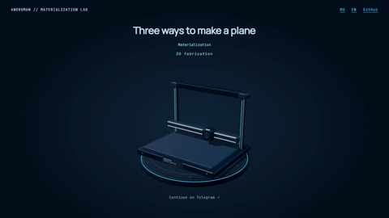
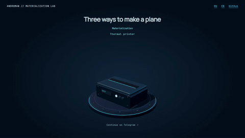
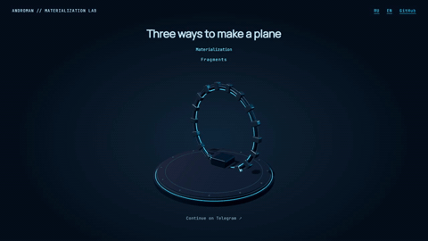

# Telegram Materialization

[Русский](README.ru.md) · [English stand](https://andromanpro.github.io/telegram-materialization/en/) · [Русский стенд](https://andromanpro.github.io/telegram-materialization/ru/)

Three self-hosted Three.js scenes for an end-of-article invitation. A fabrication rig builds an aircraft, a thermal printer releases a sheet that folds into a plane, and a mechanical portal assembles one from fragments. Each aircraft continues into an aerodynamic flight and the scene repeats.

Extracted from [androman.pro](https://androman.pro/). The standalone demo contains its own RU/EN interface, equipment inscriptions and printed receipt. Runtime assets are served locally, including Three.js r170 and fonts.

## Scenes

### Fabrication



### Folding paper



### Fragments



[Russian previews](README.ru.md) · [MP4 demonstrations](https://github.com/andromanpro/telegram-materialization/releases/tag/v1.0.0)

## Run locally

ES modules load over HTTP. From this directory run a static server.

```sh
python -m http.server 8000 --bind 127.0.0.1
```

On this project's Windows workstation use `py -3.14 -m http.server 8000 --bind 127.0.0.1`. Open `/en/` or `/ru/`. Query values `?scene=fabricator`, `?scene=printer` and `?scene=fragments` select a scene. The stand includes pause and timeline controls.

## Embed the renderer

Copy `assets/js/`, `assets/vendor/`, the styles and the matching font declarations into your static assets. Create the stage markup and pass an explicit locale.

```html
<link rel="stylesheet" href="assets/fonts/fonts.css">
<link rel="stylesheet" href="assets/css/telegram-invite.css">
<div class="tg-invite"><div class="tg-invite-stage" id="stage"></div></div>
```

```js
import { createTelegramScene } from './assets/js/telegram-scenes.js';

const stage = document.querySelector('#stage');
const canvas = document.createElement('canvas');
canvas.className = 'tg-invite-flight';
document.body.append(canvas);
const scene = createTelegramScene(canvas, 'printer', 'en', {
  anchor: stage,
  overlay: true,
});
await document.fonts.ready;
await scene.prepare();
scene.render(0);
canvas.dataset.visible = 'true';
// Drive scene.render() from your timeline. See assets/demo.js.
// Call scene.dispose() when removing the component.
```

`render(buildProgress, options)` accepts a build fraction from 0 to 1. `options.departure` advances folding/flight, `options.reset` advances a reset, and `options.cycle` creates a new set of flight conditions. `setVariant(name, locale)` reuses the renderer. Call `prepare()` after a variant change. The `departureDuration` getter supplies the departure duration in milliseconds.

The runnable timeline in [demo.js](assets/demo.js) shows cycle scheduling, background/offscreen pausing, scene selection and reduced-motion handling. For an article integration, create the component near the end of the page and activate it through an IntersectionObserver. The host controls activation and timing.

## Rendering and geometry

The pedestal is cached in a 2D canvas. Flight updates a small region around the aircraft with a base bitmap of 512 × 512 pixels and pixel ratio capped at 1.25. A merged colorless mesh restores the static equipment's depth in that region, including gaps and the portal opening. GPU drawing is skipped outside the viewport.

The printer uses a single UV-stable sheet with rigid crease panels. Its 4.5-second folding sequence continues into flight using the same geometry. The point-mass glider integrates gravity, lift, drag and seeded gusts at 1/120-second steps. Aerodynamic coefficients and sheet thickness are tuned visual approximations.

## Tests and recordings

Run `npm test` or `node --test tests/*.test.mjs`. Geometry checks cover 271 fold poses, panel rigidity and stable UVs. Flight checks cover 1,024 seeded trajectories across two launch conditions.

`tools/stand.py` validates both localized stands, creates fallback images and captures numbered frames on an isolated loopback server. Optional development dependency `playwright` and an installed Edge are required for those browser tasks. The media were captured from this stand at 1280 × 720. MP4 demonstrations use 25 fps, GIF previews use 12 fps at 480 pixels wide. All three complete cycles are included.

`tools/media.py` builds the captured frames through an installed `ffmpeg-skill` tree. Pass `--skill-dir`, `--captures`, `--output` and `--publish-media` explicitly. It saves dry-run plans, verifies output probes and produces contact sheets for visual review.

## License

Project code is MIT, copyright Roman Andriyanov. Three.js retains its [MIT license](assets/vendor/three-r170/LICENSE). Manrope and JetBrains Mono retain their [OFL](assets/fonts/Manrope-OFL.txt) [licenses](assets/fonts/JetBrainsMono-OFL.txt).
