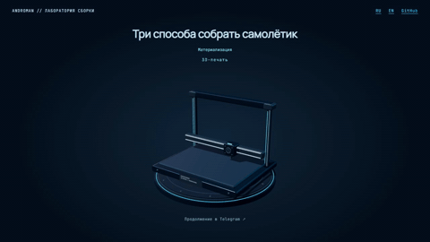
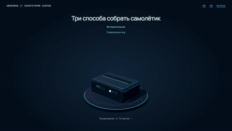
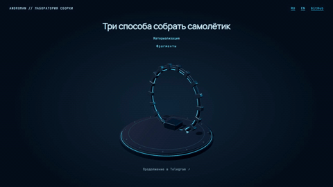

# Telegram Materialization

[English](README.md) · [Русский стенд](https://andromanpro.github.io/telegram-materialization/ru/) · [English stand](https://andromanpro.github.io/telegram-materialization/en/)

Три самостоятельные сцены на Three.js для приглашения в канал после статьи. Установка печатает самолётик, термопринтер выпускает складывающийся лист, механическое кольцо собирает модель из фрагментов. Затем самолётик летит под действием воздушных потоков, а сцена начинает следующий цикл.

Эффекты выделены из [androman.pro](https://androman.pro/). В стенде переведены интерфейс, надписи на устройствах и чек. Three.js r170, шрифты и остальные ресурсы размещены в репозитории.

## Три сцены

### 3D-печать



### Складывание бумаги



### Фрагменты



[Английские примеры](README.md) · [Демонстрации MP4](https://github.com/andromanpro/telegram-materialization/releases/tag/v1.0.0)

## Локальный запуск

Модули загружаются по HTTP. Запустите сервер из корня репозитория.

```sh
python -m http.server 8000 --bind 127.0.0.1
```

В Windows-окружении проекта используется `py -3.14 -m http.server 8000 --bind 127.0.0.1`. Откройте `/ru/` или `/en/`. Параметры `?scene=fabricator`, `?scene=printer` и `?scene=fragments` закрепляют вариант. На стенде доступны пауза и перемотка.

## Встраивание

Скопируйте `assets/js/`, `assets/vendor/` и необходимые объявления шрифтов. Создайте canvas и элемент постамента, импортируйте `createTelegramScene` и передайте язык `ru` или `en`. [Пример подключения](README.md#embed-the-renderer)

Метод `render(buildProgress, options)` принимает долю сборки от 0 до 1. Параметр `departure` задаёт складывание и полёт, `reset` — возврат механики, `cycle` — новый набор условий полёта. `setVariant(name, locale)` меняет сцену с сохранением renderer. После смены вызывается `prepare()`. Свойство `departureDuration` возвращает длительность вылета в миллисекундах.

Готовый цикл находится в [demo.js](assets/demo.js). Там же показаны остановка вне экрана и в скрытой вкладке, переключение сцен и настройка уменьшенного движения. При подключении к статье создавайте компонент у её конца и запускайте через IntersectionObserver.

## Устройство

Постамент сохраняется отдельным 2D-кадром. Во время полёта обновляется небольшая область вокруг самолётика с базовым буфером 512 × 512 пикселей и ограничением плотности 1,25. Объединённая геометрия устройств восстанавливает глубину, включая отверстие кольца. За пределами окна отрисовка пропускается.

В принтере используется единый лист с постоянными UV и поворотами панелей вокруг линий сгиба. Складывание занимает 4,5 секунды, тот же лист продолжает полёт. Аэродинамика материальной точки рассчитывает тяжесть, подъёмную силу, сопротивление и порывы ветра с шагом 1/120 секунды. Коэффициенты и толщина бумаги подобраны для визуального эффекта.

## Проверки и записи

Запуск проверок — `npm test` или `node --test tests/*.test.mjs`. Геометрия проверяется в 271 положении, включая постоянство размеров панелей и UV. Для полёта проверяются 1 024 траектории с двумя начальными направлениями.

`tools/stand.py` проверяет оба языка, создаёт статичные изображения и снимает кадры с отдельного сервера на loopback. Для браузерной части нужны дополнительная зависимость `playwright` и установленный Edge. Записи сделаны с этого стенда в размере 1280 × 720. MP4 содержат 25 кадров в секунду, GIF — 12 кадров в секунду при ширине 480 пикселей. Включены полные циклы всех трёх сцен.

## Лицензии

Код проекта опубликован под MIT, автор Roman Andriyanov. Three.js сохраняет свою [MIT-лицензию](assets/vendor/three-r170/LICENSE). Manrope и JetBrains Mono распространяются по [OFL](assets/fonts/Manrope-OFL.txt) [с сохранением лицензий](assets/fonts/JetBrainsMono-OFL.txt).
